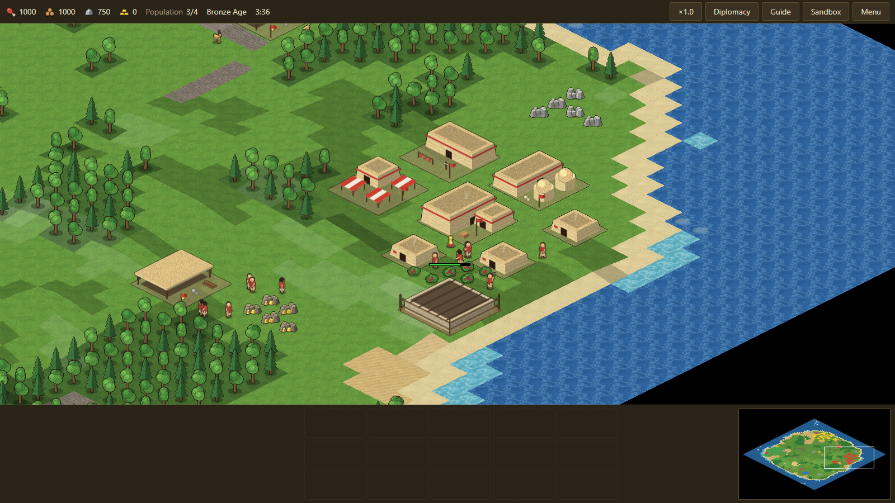
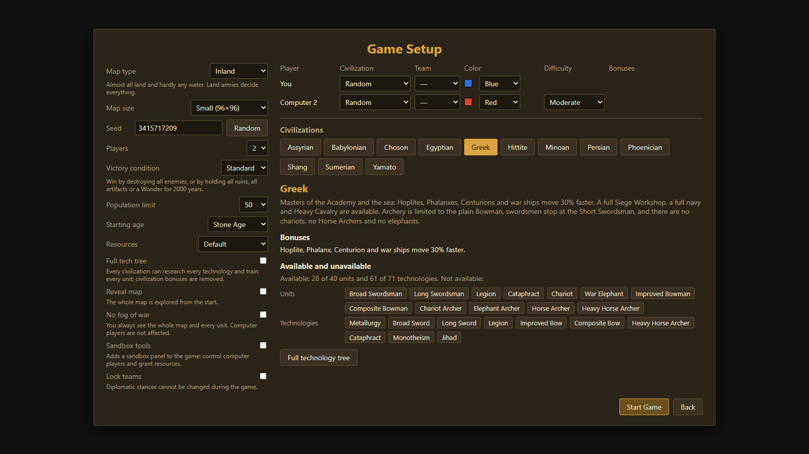
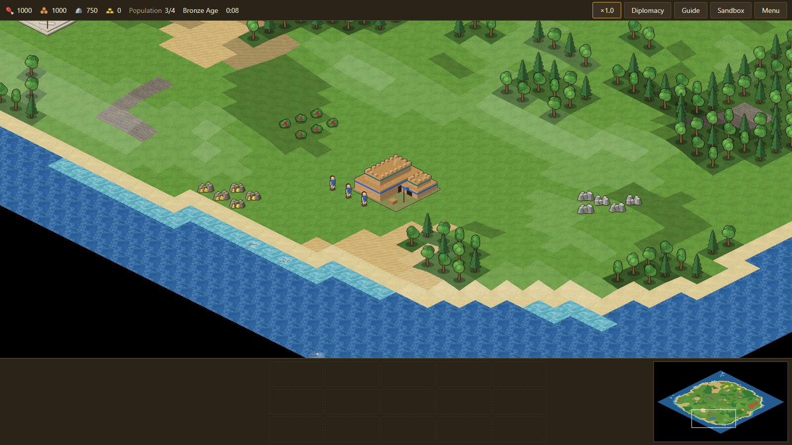
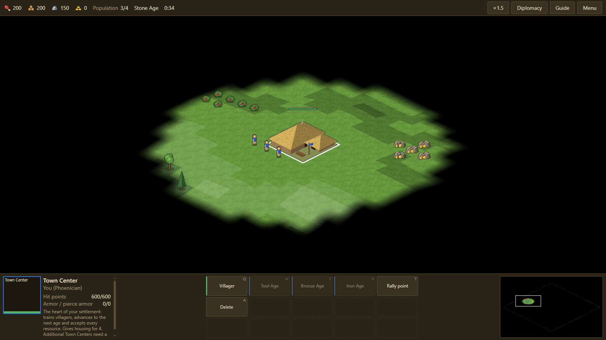
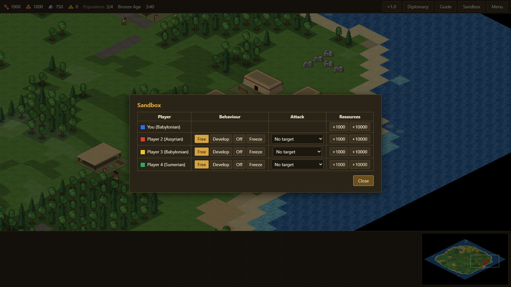

# Empires

A browser real-time strategy game in the spirit of Age of Empires (1997), written from scratch in TypeScript. No original game assets are used: every sprite is generated procedurally, the music is generative.

**▶ Play: [dalidovich.github.io/Empires](https://dalidovich.github.io/Empires/)**



## Features

- **12 civilizations** — Assyrian, Babylonian, Choson, Egyptian, Greek, Hittite, Minoan, Persian, Phoenician, Shang, Sumerian, Yamato — each with its own bonuses and tech tree restrictions.
- **44 units, 22 buildings, 71 technologies**, four ages from the Stone Age to the Iron Age.
- **Seeded map generator** — Small Islands, Large Islands, Coastal, Inland, Highland; sizes from 72×72 to 200×200.
- **Computer opponents** on five difficulty levels, from Easiest to Hardest, with economy, military, naval, scouting, relic and diplomacy behaviour.
- **Up to 8 players**, teams, diplomacy, conquest and standard victory (ruins, artifacts, Wonder).
- **Sandbox mode** — grant resources and steer computer players: let them develop, freeze them or send them to attack a chosen target.
- **In-game guide** that shows the exact chain of steps unlocking any unit, building or technology.
- Saves in IndexedDB with export/import to a file, autosave, English and Russian UI.

## Screenshots

| | |
|---|---|
|  |  |
| Game setup with civilization overview | Coastal map in the Bronze Age |
|  |  |
| Stone Age start, Town Center selected | Sandbox panel controlling AI players |

## Tech stack

TypeScript (strict), Vite, PixiJS 8 (WebGL), HTML/CSS UI over the canvas, deterministic simulation in a Web Worker, Web Audio, IndexedDB + localStorage, Vitest.

The simulation is fully deterministic: the same seed and commands always produce the same game, which is what makes saves, replays of AI-vs-AI matches and headless testing possible.

```
UI ──commands──► Web Worker ──► simulation ──► game state
 ▲                                                │
 └──── fog-filtered player view + events ◄────────┘
```

## Running locally

Requires Node.js 22.

```bash
npm install
npm run assets   # generate sprite atlases into public/assets (once after cloning)
npm run dev      # start the dev server
```

| Command | Action |
|---|---|
| `npm run build` | type-check and build to `dist/` |
| `npm run test:fast` | unit and integration tests, under a minute |
| `npm test` | full suite including headless AI-vs-AI acceptance games |
| `npm run lint` | ESLint, including module boundary rules |
| `npm run sim -- --seed 1 --map inland --size tiny --players assyrian:moderate,greek:hard` | run a headless AI-vs-AI game in Node |

## Deployment

Every push to `master` is built and published to GitHub Pages by [.github/workflows](.github/workflows).
